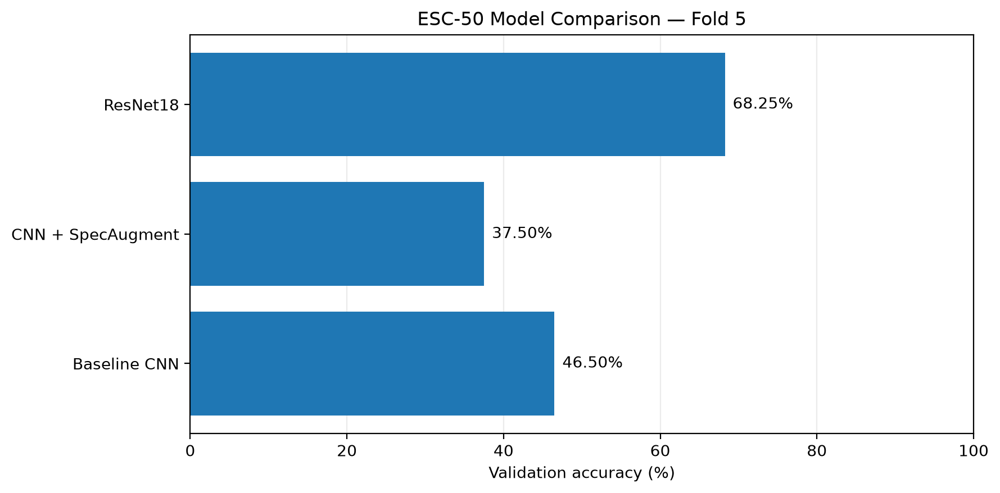
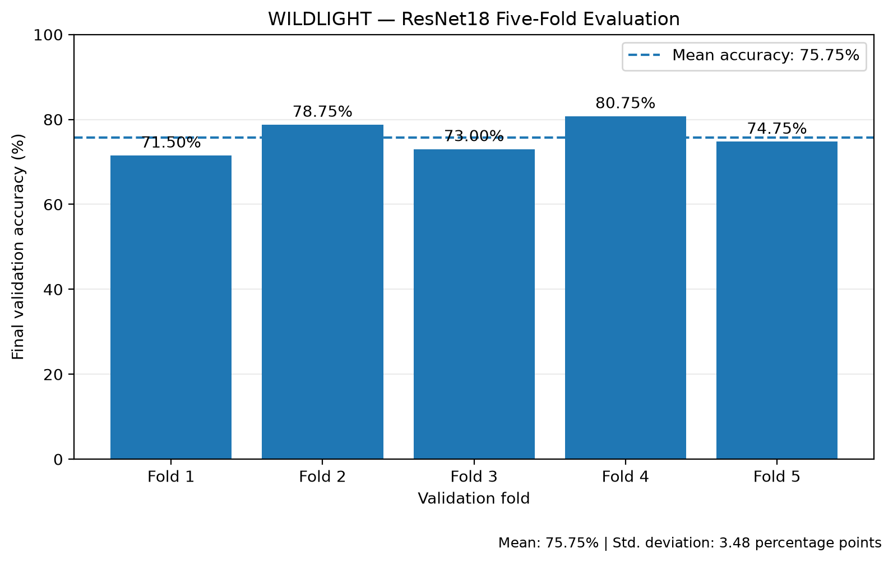

# WILDLIGHT — Environmental Audio Intelligence

**Experimental machine learning for environmental sound classification.**

## 1. Project Overview

WILDLIGHT is an environmental audio classification research-engineering project investigating how deep learning models recognize environmental sounds.

The system takes a five-second audio recording, converts it into a mel spectrogram, and predicts one of 50 ESC-50 sound categories.

The project investigates three training approaches and evaluates model performance across the official ESC-50 folds.

### Research Questions

1. Can a CNN trained from scratch learn useful environmental sound patterns?
2. Does SpecAugment improve generalization to unseen audio clips?
3. Does pretrained ResNet18 perform better than the original CNN?
4. How consistent is performance across all five official validation folds?

### Engineering Implementation

- Centralized audio preprocessing shared by training and inference.
- Audio prediction using the trained ResNet18 model.
- A local Gradio interface for audio uploads and predictions.

## 2. Model Evaluation

### Fold-5 Model Comparison

| Model | Validation Accuracy |
|---|---:|
| Baseline CNN | 46.50% |
| CNN + SpecAugment | 37.50% |
| ResNet18 | 68.25% |



The primary ResNet18 comparison uses the final checkpoint and achieves 68.25% accuracy on validation fold 5.

A separate validation-selected checkpoint reached 76.75% on the same fold. This is a diagnostic result because the checkpoint was selected using that validation fold, so it is not an unbiased comparison.

### ResNet18 Five-Fold Cross-Validation

| Validation Fold | Final Accuracy |
|---|---:|
| Fold 1 | 71.50% |
| Fold 2 | 78.75% |
| Fold 3 | 73.00% |
| Fold 4 | 80.75% |
| Fold 5 | 74.75% |
| **Mean** | **75.75%** |

**Population standard deviation:** 3.48 percentage points.



The fold-5 model comparison and five-fold cross-validation are separate evaluation workflows. The cross-validation results provide an estimate of performance consistency across the five official ESC-50 folds; they do not establish performance on every possible environmental recording.

For detailed experiment results and interpretation, see [RESULTS.md](RESULTS.md).

## 3. Shared Audio Preprocessing

Training and inference use the shared preprocessing implementation in `dataset.py`.

| Setting | Value |
|---|---|
| Sample rate | 22,050 Hz |
| Audio clip length | 5 seconds |
| Mel-spectrogram bins | 128 |
| Decibel conversion | `librosa.power_to_db` |
| Normalization | `(m + 40) / 40` |

Centralizing these operations helps maintain consistent preprocessing between training and inference.

## 4. Audio Inference

WILDLIGHT includes a prediction script and a local Gradio interface for testing environmental sound recordings.

### Predict from an audio file

Ensure that the ESC-50 dataset is available in `ESC-50/` and that the trained checkpoint `esc50_resnet18_best.pth` is present in the project root.

Run:

```bash
python predict.py "ESC-50/audio/1-100032-A-0.wav"
```

The script returns the five highest-scoring sound categories.

### Launch the Gradio interface

With the project virtual environment active, run:

```bash
python app.py
```

Open the local URL printed in the terminal, usually:

`http://127.0.0.1:7860`

Upload an audio recording to view the model's top five predictions.

The application currently runs locally; cloud deployment is outside the project scope.

**Interpretation note:** The displayed scores are softmax outputs and are not necessarily calibrated probabilities.

## 5. Project Structure

| File | Purpose |
|---|---|
| `dataset.py` | Dataset loading and shared audio preprocessing |
| `model.py` | Baseline CNN architecture |
| `train.py` | Baseline CNN training |
| `train_specaugment.py` | CNN training with SpecAugment |
| `resnet_model.py` | ResNet18 model architecture |
| `train_resnet18.py` | ResNet18 training |
| `cross_validate_resnet18.py` | Five-fold cross-validation |
| `plot_cv_results.py` | Cross-validation result visualization |
| `compare_models.py` | Fold-5 model comparison |
| `predict.py` | Audio classification inference |
| `app.py` | Local Gradio audio-upload interface |
| `RESULTS.md` | Detailed experimental results |

## 6. Dataset and Checkpoints

WILDLIGHT uses the ESC-50 environmental sound classification dataset, containing 2,000 five-second audio clips across 50 categories.

Dataset source: [ESC-50 on GitHub](https://github.com/karolpiczak/ESC-50).

The dataset and trained model checkpoints are kept locally and excluded from this Git repository. They must be available on your machine to run the prediction script and interface.

## 7. Current Scope

The project focuses on the four research questions listed above, model evaluation across the official ESC-50 folds, and a reproducible inference workflow.

The Gradio interface supports local audio testing. Additional datasets, new model experiments, and cloud deployment are outside the current scope.